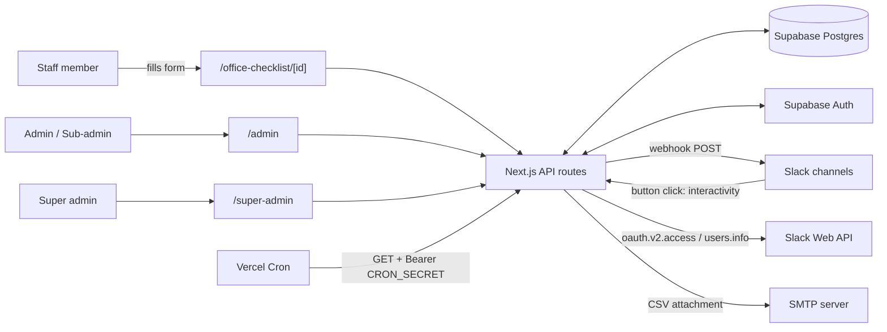
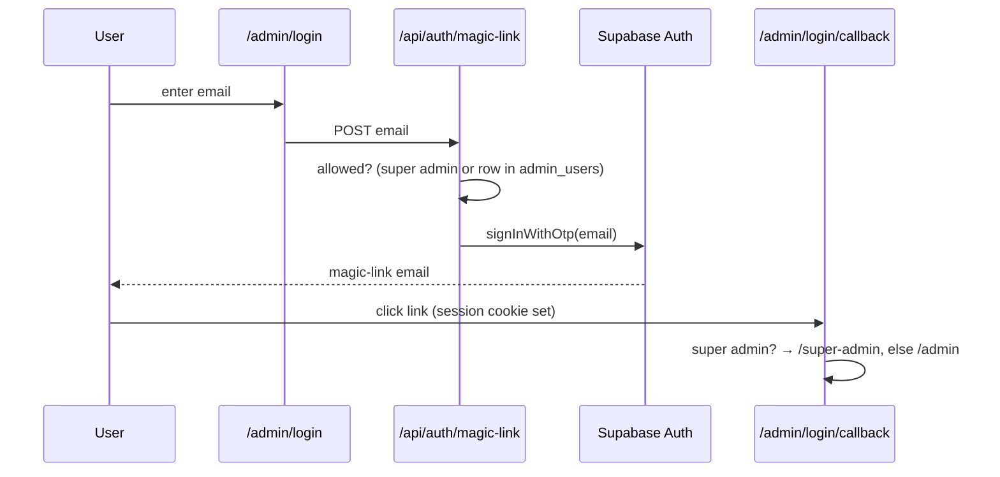
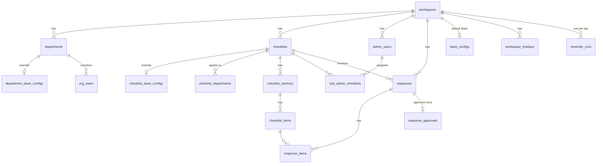
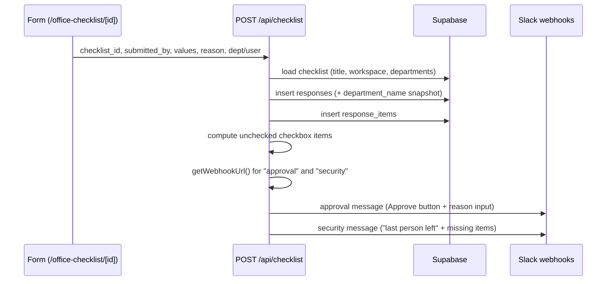
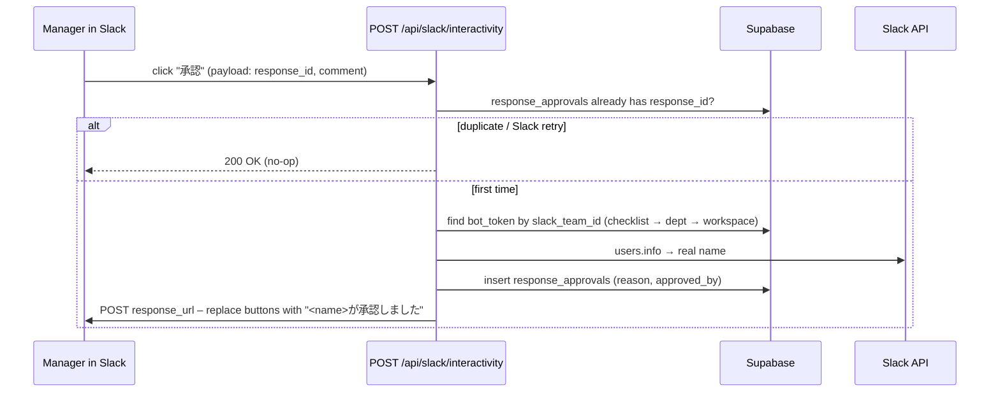

# Architecture

A multi-tenant **office-closing checklist** app. Staff submit a checklist from a web form; the submission is stored in Supabase and posted to Slack, where a manager approves it with one click. Daily reminders and a monthly CSV report run on cron.

## 1. Tech stack

| Layer | Technology |
|---|---|
| Framework | Next.js 16 (App Router, `proxy.ts` instead of `middleware.ts`), React 19 |
| UI | Tailwind CSS 4, shadcn/Radix UI (`components/ui`), lucide-react |
| Database + Auth | Supabase (Postgres, Auth via email magic link / OTP) |
| Messaging | Slack OAuth v2, Incoming Webhooks, Block Kit interactivity, `users.info` |
| Email | nodemailer (SMTP) |
| Hosting / scheduling | Vercel (Vercel Cron, see `vercel.json`) |

## 2. High-level view



## 3. Repository layout

```
app/
  page.tsx                      Landing page
  layout.tsx                    Root layout
  office-checklist/             Public: checklist list + /[id] submission form
  admin/                        Admin dashboard (tabbed) + login + magic-link callback
    ChecklistsTab / DepartmentsTab / ResponsesTab / ApprovalsTab / SettingsTab
    SlackConnectPanel.tsx       "Connect Slack" buttons (per channel / dept / checklist)
  super-admin/page.tsx          Workspace (tenant) management
  api/
    checklist/                  POST  submit a checklist (public)
    checklists/ [id]/ [id]/copy CRUD + duplicate checklists
    departments/  org-users/    CRUD
    responses/  approvals/      Read submissions / approvals (scoped)
    settings/                   Read workspace Slack config
    holidays/ [id]/             Workspace holidays (skip reminders)
    sub-admins/ [id]/           Manage sub-admins + checklist assignments
    super-admin/workspaces/     Tenant CRUD (super admin only)
    auth/magic-link/  auth/me   Login + current-user context
    slack/install/              Starts Slack OAuth
    slack/oauth/callback/       Finishes OAuth, saves webhook + bot token
    slack/interactivity/        Receives the "Approve" button click
    cron/daily-check/           Missing-submission reminders
    cron/monthly-report/        Monthly CSV email
lib/
  supabase-admin.ts             Service-role client (server only, bypasses RLS)
  supabase.ts                   Browser client (anon key)
  auth-helpers.ts               getUserContext(), isSuperAdmin()
  slack-helpers.ts              getWebhookUrl() – 3-tier routing
proxy.ts                        Route guard for /admin/*
vercel.json                     Cron schedules
```

## 4. Multi-tenancy and roles

Every business row carries a `workspace_id`. API routes call `supabaseAdmin` (service role, bypasses RLS), so **tenant isolation is enforced in application code**: each route resolves the caller with `getUserContext()` and filters by `ctx.workspaceId`.

| Role | How determined | Capabilities |
|---|---|---|
| Staff (anonymous) | no login | View a checklist and submit it |
| Sub-admin | `admin_users.is_main_admin = false` | Read responses only for checklists in `sub_admin_checklists` |
| Main admin | `admin_users.is_main_admin = true` | Full control of own workspace: checklists, departments, users, sub-admins, holidays, Slack |
| Super admin | email in `SUPER_ADMIN_EMAILS` env var | Create / rename / delete workspaces |

### Auth flow



- `proxy.ts` guards `/admin/*` optimistically using `getSession()` (cookie only, no network call) and redirects to `/admin/login` if absent.
- Real validation happens in every API route via `supabase.auth.getUser()` inside `getUserContext()`.

## 5. Data model (inferred from queries)



Notes:
- `responses.department_name` is a snapshot so history survives department deletion.
- `*_slack_configs` / `slack_configs` hold `approval_url`, `security_url`, `reminder_url`, `bot_token`, `slack_team_id`.
- `reminder_runs (workspace_id, run_date)` acts as a once-per-day lock (insert fails on duplicate).
- "Large" checklists (`is_large_checklist`) let the submitter pick the department; otherwise it comes from `checklist_departments` / `checklists.department_id`.

## 6. Key workflows

### 6.1 Checklist submission



The form loads its definition from `GET /api/checklists/[id]` and the staff list from `GET /api/org-users?department_id=&checklist_id=`.

### 6.2 Slack approval (interactivity)



### 6.3 Slack connection (OAuth)

1. `SlackConnectPanel` links to `/api/slack/install?workspace=&channel=&department_id=|checklist_id=`.
2. The route redirects to Slack's authorize URL; scope: `chat:write, incoming-webhook, channels:read, users:read, users.profile:read`. `state = <slug>:<channel>[:dept|checklist:<id>]`.
3. `/api/slack/oauth/callback` exchanges the code, then upserts the webhook URL into the table for that tier (checklist, department or workspace), choosing the column by channel type (`approval` / `security` / `reminder`).
4. `bot_token` / `slack_team_id` are overwritten only if the channel is `approval`, no token exists yet, or the same Slack team reconnects. This prevents a security/reminder connection from clobbering the token the approval flow relies on.

### 6.4 Webhook resolution (`lib/slack-helpers.ts`)

`getWebhookUrl(checklistId, departmentId, type, workspaceId)` returns the first non-empty URL from:

1. `checklist_slack_configs` (most specific)
2. `department_slack_configs`
3. `slack_configs` (workspace default)

### 6.5 Daily reminder (`/api/cron/daily-check`)

Vercel Cron: `15 14 * * 1-5` (UTC, weekdays). Per workspace:

1. Claim the day by inserting into `reminder_runs`; a duplicate means already processed.
2. Skip if today is in `workspace_holidays`.
3. Find checklists with no `responses` today.
4. Group missing checklists by reminder webhook (checklist override, else each assigned department, else workspace default) and send one message per channel.

Optional `?workspace=<name>` limits a run to one workspace.

### 6.6 Monthly report (`/api/cron/monthly-report`)

Vercel Cron: `0 6 1 * *`. For each main admin, build a CSV of the previous month's responses with approver/comment (UTF-8 BOM for Excel) and email it via SMTP. Workspaces with no data are skipped.

Both cron routes require `Authorization: Bearer $CRON_SECRET` when the variable is set.

## 7. Admin dashboard

`/admin` (`app/admin/page.tsx`) calls `/api/auth/me` for the `UserContext` and renders tabs by role:

| Tab | Purpose | Main APIs |
|---|---|---|
| Checklists | Create / edit / copy / delete; sections and items | `/api/checklists*` |
| Departments | CRUD, per-department Slack config | `/api/departments` |
| Responses | Browse submissions | `/api/responses` |
| Approvals | Approval status | `/api/approvals` |
| Settings | Workspace Slack, holidays, sub-admins, org users | `/api/settings`, `/api/holidays*`, `/api/sub-admins*`, `/api/org-users` |

## 8. Environment variables

| Variable | Used for |
|---|---|
| `NEXT_PUBLIC_SUPABASE_URL`, `NEXT_PUBLIC_SUPABASE_ANON_KEY` | Supabase clients (browser, SSR, proxy) |
| `NEXT_PUBLIC_SUPABASE_SERVICE_ROLE_KEY` | Service-role client in `lib/supabase-admin.ts` |
| `SUPER_ADMIN_EMAILS` | Comma-separated super admin emails |
| `NEXT_PUBLIC_PUBLIC_SITE_URL` | Magic-link redirect target |
| `NEXT_PUBLIC_BASE_URL` | Slack OAuth redirect URI and post-OAuth redirects |
| `SLACK_CLIENT_ID`, `SLACK_CLIENT_SECRET` | Slack OAuth |
| `CRON_SECRET` | Authorizes cron routes |
| `SMTP_HOST`, `SMTP_PORT`, `SMTP_SECURE`, `SMTP_USER`, `SMTP_PASS`, `EMAIL_FROM` | Monthly report email |

## 9. Design observations and risks

- **Service-role key is prefixed `NEXT_PUBLIC_`**, which makes Next.js inline it into any client bundle that imports it. `supabase-admin.ts` is only imported server-side today, but renaming it (e.g. `SUPABASE_SERVICE_ROLE_KEY`) removes the risk.
- **`/api/slack/interactivity` does not verify Slack's request signature** (`X-Slack-Signature` / signing secret). Anyone who can reach the URL and knows a `response_id` can forge an approval. Adding signature verification is recommended.
- **`POST /api/checklist` is unauthenticated** by design (staff submission) and trusts `checklist_id`; abuse is limited only by id guessing. Consider rate limiting.
- Tenant isolation relies on every route filtering by workspace; RLS is bypassed by the service role.
- `proxy.ts` only checks for a session; authorization (role, workspace) is always re-checked in the API layer.
- Cron dates use UTC day boundaries, so "today" may differ from the local business day depending on the office timezone.
