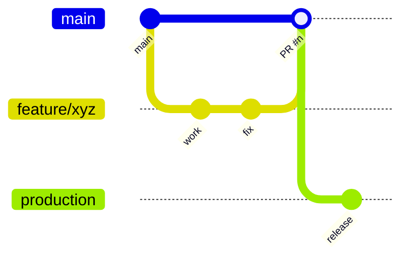

# Code Organization on GitHub

How the repository is laid out, how branches are used, and where to put new code. For how the app works at runtime, see [ARCHITECTURE.md](ARCHITECTURE.md).

- **Repository:** `seinxera11-boop/NextJS-Form-with-Slack-Interactivity`
- **Default branch:** `main`
- **Type:** single Next.js 16 app (not a monorepo), TypeScript, deployed to Vercel

## 1. Branches

| Branch | Purpose |
|---|---|
| `main` | Default branch. All finished work is merged here by pull request. |
| `production` / `Production` | Deployment branches (note: two branches differing only by case exist on the remote; consider keeping one). |
| `test` | Staging / testing branch. |
| `feature/<name>` | One branch per feature, e.g. `feature/slack-config-change`, `feature/checklist-wise-slack-config`. |
| `docs/<name>` | Documentation-only changes, e.g. `docs/architecture`. |
| `feat/<name>` | Local working branches, e.g. `feat/teamConnect`. |

### Workflow



1. Branch from `main` as `feature/<short-name>` (or `docs/<name>`).
2. Commit in small steps; short messages in the existing style (`fix delete workspace`, `completed holiday addition per admin`).
3. Open a pull request into `main`. History shows PRs #41–#47 merged this way (merge commits).
4. After merge, delete the branch.
5. Promote to `production` (or `test`) for deployment.

## 2. Folder structure

```
.
├── app/                     Next.js App Router: pages AND API routes
│   ├── page.tsx, layout.tsx, globals.css
│   ├── office-checklist/    Staff-facing form (list + [id])
│   ├── admin/               Admin dashboard, one *Tab.tsx per tab, login/
│   ├── super-admin/         Tenant (workspace) management page
│   └── api/                 Route handlers (route.ts), one folder per resource
│       ├── checklist(s)/    submit, CRUD, copy
│       ├── departments/ org-users/ holidays/ sub-admins/ settings/
│       ├── responses/ approvals/
│       ├── auth/            magic-link, me
│       ├── slack/           install, oauth/callback, interactivity
│       ├── cron/            daily-check, monthly-report
│       └── super-admin/workspaces/
├── components/ui/           Reusable shadcn/Radix primitives (button, card, input…)
├── lib/                     Shared server/client helpers (no UI)
│   ├── supabase-admin.ts    Service-role Supabase client
│   ├── supabase.ts          Browser Supabase client
│   ├── auth-helpers.ts      getUserContext(), isSuperAdmin()
│   ├── slack-helpers.ts     getWebhookUrl()
│   └── utils.ts             cn() and misc
├── public/                  Static assets
├── proxy.ts                 Route guard for /admin/*
├── vercel.json              Cron schedules
├── next.config.ts, tsconfig.json, eslint.config.mjs, postcss.config.mjs
├── components.json          shadcn CLI config
├── package.json / package-lock.json
├── AGENTS.md / CLAUDE.md    Instructions for AI coding assistants
├── ARCHITECTURE.md          How the app works
├── CODE_ORGANIZATION.md     This file
├── CHECKLIST_SLACK_CONFIG_PLAN.md   Design plan: per-checklist Slack config
└── HOLIDAY_TRACKING_PLAN.md         Design plan: in-app holidays (replaces Google Calendar)
```

## 3. Conventions

| Topic | Convention |
|---|---|
| Imports | `@/` alias maps to the repo root (`@/lib/...`, `@/components/ui/...`). |
| Routing | File-based. A page is `page.tsx`; an API endpoint is `route.ts` exporting `GET/POST/PATCH/DELETE`. |
| Dynamic routes | `[id]` folders; `params` is a `Promise` in this Next.js version. |
| Page-local components | Live next to the page (`app/admin/*Tab.tsx`), shared types in `app/admin/types.ts`. |
| Shared UI | `components/ui/` only; add new ones via the shadcn CLI. |
| Server-only logic | `lib/`, always through `supabaseAdmin`; never import it into client components. |
| Auth in APIs | Call `getUserContext(req)` (admins) or `isSuperAdmin(req)` first; filter by `ctx.workspaceId`. |
| Cron routes | `GET`, protected by `Authorization: Bearer $CRON_SECRET`; schedule in `vercel.json`. |
| Secrets | Environment variables only. `.env*` is git-ignored. List in ARCHITECTURE.md §8. |

## 4. What is and isn't committed

Ignored by `.gitignore`: `node_modules`, `.next`, `.env*`, `.vercel`, `*.tsbuildinfo`, `build`, `coverage`.
Committed: source, lockfile, config, plan/architecture docs.

There is no `.github/` folder, so there are currently no GitHub Actions, PR templates or CODEOWNERS. Vercel builds from the connected branches.

## 5. Where to put new code

| I want to add… | Put it in |
|---|---|
| A new public or admin page | `app/<route>/page.tsx` |
| A new admin dashboard tab | `app/admin/<Name>Tab.tsx` and register it in `app/admin/page.tsx` |
| A new API endpoint | `app/api/<resource>/route.ts` |
| A helper used by several routes | `lib/<topic>-helpers.ts` |
| A reusable UI primitive | `components/ui/` (shadcn CLI) |
| A scheduled job | `app/api/cron/<job>/route.ts` plus an entry in `vercel.json` |
| A larger design proposal | `<TOPIC>_PLAN.md` at the root, as done for the two existing plans |
