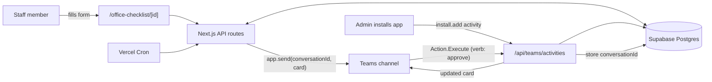

# Migrating from Slack to Microsoft Teams

How to replace the Slack integration in this app with Microsoft Teams, using the
Microsoft Teams SDK v3 (`@microsoft/teams.*`, repo `microsoft/teams-sdk`).

Read [ARCHITECTURE.md](ARCHITECTURE.md) first — this document assumes it and only
covers the messaging layer. Everything else (Supabase, multi-tenancy, auth, cron,
the admin dashboard, the submission form) is unchanged.

---

## 1. The one thing that decides the whole design

Slack and Teams look superficially similar — post a message to a channel, put a
button on it, receive the click on a webhook. They are not similar, and one
difference drives every decision below.

**Slack gives you a per-channel Incoming Webhook URL. Teams is taking that away.**

Today's Slack flow stores a webhook URL per channel per tier
(`approval_url`, `security_url`, `reminder_url`) and posts to it with a bare
`fetch`. There is no equivalent in Teams that is both durable and interactive:

| Teams option | Interactive buttons | Status |
|---|---|---|
| Office 365 Connector webhooks | Legacy cards only | **Being switched off; rollout completes May 2026** |
| Power Automate "Workflows" webhooks | Adaptive Cards render, but `Action.Execute` has no app to route to | Supported, but posts as "Flow bot" — not your app, no custom name/icon |
| **Bot (Teams SDK) + stored `conversationId`** | Full `Action.Execute` round trip | **The supported path** |

A webhook-for-webhook swap is therefore a dead end. You must become a **bot**.
That is the central structural change, and it inverts the connection model:

- **Slack:** admin picks a channel → Slack hands you a URL → you store the URL.
- **Teams:** admin installs your app into a team/channel → Teams sends you an
  `install.add` activity → you store the `conversationId` from it.

You cannot post into a Teams channel you were never installed into. There is no
URL to paste. This is the single biggest behavioural change for your admins.

---

## 2. Mapping the concepts

| Slack | Teams | Notes |
|---|---|---|
| Workspace (`team.id`) | Tenant (`tenantId`, an Entra ID GUID) | Your tenant anchor |
| Channel + Incoming Webhook URL | `conversationId` (channel or chat) | Opaque string; store it, don't construct it |
| `bot_token` (`xoxb-…`) per workspace | One app registration (`CLIENT_ID`/`CLIENT_SECRET`) for **all** tenants | Big simplification — see §4 |
| OAuth v2 install flow | App install (Teams admin uploads/approves the app) | No per-tenant OAuth round trip for bot messaging |
| Block Kit JSON | Adaptive Card JSON | Different schema; rewrite the payloads |
| `type: "button"` + `action_id` | `Action.Execute` + `verb` | |
| `type: "input"` / `plain_text_input` | `Input.Text` | Values arrive in `activity.value.action.data` |
| `POST /api/slack/interactivity` | `POST /api/teams/activities` | One endpoint for **all** activity types, not just clicks |
| `payload.response_url` → `replace_original` | `activity.replyToId` + update API, or return a card response | |
| `users.info` → real name | `activity.from.name` | Already on the activity; **no extra API call needed** |
| `<!channel>` | `<at>…</at>` mention entity, or plain text | Teams has no direct `@channel` in a card |
| Signing-secret verification | Bot Framework JWT validation | **Done for you by the SDK** — see §7 |

---

## 3. Target architecture



Compared with the Slack diagram in ARCHITECTURE.md §2: the outbound
`webhook POST` becomes an authenticated Bot Framework call, the inbound
interactivity endpoint widens into a general activity endpoint, and a new
inbound path (installation) is what populates your routing table.

### Routing stays three-tier

The `getWebhookUrl()` fallback chain (checklist → department → workspace) is
good design and is worth keeping verbatim. Only the value it resolves changes:
a `conversationId` instead of a URL.

---

## 4. Multi-tenancy: this gets *simpler*

Slack forced you to store a `bot_token` per tier, with the awkward
`canWriteToken` logic in [callback/route.ts](app/api/slack/oauth/callback/route.ts#L111-L123)
guarding against a security/reminder connect clobbering the approval token.

**Teams needs none of that.** You register **one** multi-tenant Entra ID app.
Its `CLIENT_ID` + `CLIENT_SECRET` live in env vars and authenticate you to every
customer tenant. There is no per-tenant secret to store, rotate, or accidentally
overwrite. Delete that whole class of bug.

What you store per tenant is only identity and addressing:

- `workspaces.teams_tenant_id` — replaces `slack_team_id`
- `*_teams_configs.approval_conversation_id` / `security_…` / `reminder_…`

Register the app with `signInAudience: AzureADMultipleOrgs`.

> **Security note.** Because one credential now reaches all tenants, the
> tenant-isolation check moves to the *inbound* side: on every activity, confirm
> `activity.conversation.tenantId` matches the workspace you resolved from the
> stored `conversationId`. Never trust a `response_id` in card data without that
> check. This is the Teams-shaped version of the forged-approval risk flagged in
> ARCHITECTURE.md §9.

---

## 5. Packages

```bash
npm install @microsoft/teams.apps @microsoft/teams.api @microsoft/teams.cards
```

- `@microsoft/teams.apps` — the `App` class, activity routing
- `@microsoft/teams.api` — activity/response types, `MessageActivity`
- `@microsoft/teams.cards` — Adaptive Card builders

Installed versions are **2.1.0** — note the runtime packages are on a different
release line from `@microsoft/teams.cli` (3.0.3). Don't assume a doc page written
against 3.x matches the installed types; the type definitions in
`node_modules/@microsoft/teams.apps/dist/*.d.ts` are the source of truth, and
checking them is what caught the two corrections in §5 and §7.

The `@microsoft/teams.cli` you installed globally is a **scaffolding and
provisioning tool** (`teams --help`). It is not a runtime dependency. Use it to
register the app and bot; don't add it to `package.json`.

### The serverless caveat — read before you write code

The SDK's quickstart assumes it owns a long-lived HTTP server:

```ts
const adapter = new ExpressAdapter(server);
const app = new App({ httpServerAdapter: adapter });
await app.initialize();
server.listen(3978);
```

**That model does not fit Next.js route handlers on Vercel.** There is no server
for the SDK to own, and per ARCHITECTURE.md you deploy to Vercel. Two viable
shapes:

**(a) Recommended — a custom `IHttpServerAdapter` for Next.js.** The SDK exposes
the transport seam as an exported interface (`IHttpServerAdapter`, from
`@microsoft/teams.apps`). `IHttpServer` keeps the Teams protocol logic — **including
inbound JWT validation** — and delegates only wire concerns to the adapter. Both
`start()` and `serveStatic()` are optional, so a serverless adapter is a small
shim: `registerRoute()` captures the handler, and your Next.js route calls it with
`{ body, headers }`. You keep `export const runtime = "nodejs"` (as
[app/api/checklist/route.ts](app/api/checklist/route.ts#L5) already does) and
Next.js keeps control of routing. Outbound `app.send()` works from any route or
cron job.

> **Do not call `app.process()` directly from a route handler.** It takes an
> already-validated `IToken`, not raw headers — see §7.

**(b) Separate always-on service.** Run the SDK's own server (Azure App Service,
Container Apps, a Node host) and have Next.js call it. More moving parts;
justified only if you later want streaming, SSO, or long-running agent features.

Start with (a).

---

## 6. Outbound: replacing the webhook POSTs

### 6.1 The new helper — `lib/teams-helpers.ts`

Mirror the existing [lib/slack-helpers.ts](lib/slack-helpers.ts) exactly, so the
three-tier fallback is preserved and reviewable side by side:

```ts
import { supabaseAdmin } from "./supabase-admin";

type TeamsChannelType = "approval" | "security" | "reminder";

export async function getConversationId(
  checklistId: number | null,
  departmentId: number | null,
  type: TeamsChannelType,
  workspaceId: string
): Promise<string | null> {
  const column = `${type}_conversation_id`;

  // Step 1: checklist-level override (most specific)
  if (checklistId) {
    const { data } = await supabaseAdmin
      .from("checklist_teams_configs")
      .select(column)
      .eq("checklist_id", checklistId)
      .maybeSingle();
    if (data?.[column]) return data[column];
  }

  // Step 2: department config
  if (departmentId) {
    const { data } = await supabaseAdmin
      .from("department_teams_configs")
      .select(column)
      .eq("department_id", departmentId)
      .maybeSingle();
    if (data?.[column]) return data[column];
  }

  // Step 3: workspace default
  const { data } = await supabaseAdmin
    .from("teams_configs")
    .select(column)
    .eq("workspace_id", workspaceId)
    .maybeSingle();

  return data?.[column] ?? null;
}
```

### 6.2 The app singleton — `lib/teams-app.ts`

```ts
import { App } from "@microsoft/teams.apps";

let appPromise: Promise<App> | null = null;

export function getTeamsApp(): Promise<App> {
  appPromise ??= (async () => {
    // Reads CLIENT_ID / CLIENT_SECRET / TENANT_ID from the environment.
    const app = new App();
    await app.initialize();
    return app;
  })();
  return appPromise;
}
```

The SDK picks its auth method from the environment: `CLIENT_ID` + `CLIENT_SECRET`
selects client-secret auth. Do **not** prefix these `NEXT_PUBLIC_` — see
ARCHITECTURE.md §9 for why that prefix is already a live risk in this repo.

### 6.3 The approval card

This replaces the Block Kit payload at
[app/api/checklist/route.ts:112-156](app/api/checklist/route.ts#L112-L156).

```ts
import {
  AdaptiveCard, TextBlock, TextInput, ActionSet, ExecuteAction,
} from "@microsoft/teams.cards";

export function buildApprovalCard(opts: {
  responseId: number;
  checklistId: number;
  submittedBy: string;
  departmentName: string;
  bodyText: string;
}) {
  return new AdaptiveCard(
    new TextBlock(
      `${opts.departmentName}の ${opts.submittedBy} さんから新しい提出があります`,
      { size: "Large", weight: "Bolder", wrap: true }
    ),
    new TextBlock(opts.bodyText, { wrap: true }),
    new TextInput({ id: "reason" }).withLabel("承認の理由を教えてください"),
    new ActionSet(
      new ExecuteAction({ title: "承認" })
        .withData({
          verb: "approve",
          response_id: opts.responseId,
          checklist_id: opts.checklistId,
          submitted_by: opts.submittedBy,
        })
        .withAssociatedInputs("auto")
    )
  );
}
```

Two details that differ from Slack and will bite you otherwise:

- **`.withAssociatedInputs("auto")` is mandatory.** Without it the `reason`
  input is not collected and you will silently always get the fallback comment.
- **`wrap: true` on every `TextBlock`.** Adaptive Cards do not wrap by default;
  your Japanese multi-line missing-items text will be clipped.

### 6.4 Sending

```ts
import { getTeamsApp } from "@/lib/teams-app";
import { getConversationId } from "@/lib/teams-helpers";
import { MessageActivity } from "@microsoft/teams.api";

const [approvalConv, securityConv] = await Promise.all([
  getConversationId(checklist_id, resolvedDeptId, "approval", workspaceId),
  getConversationId(checklist_id, resolvedDeptId, "security", workspaceId),
]);

const app = await getTeamsApp();

if (approvalConv) {
  await app.send(approvalConv, new MessageActivity().addCard("adaptive", approvalCard));
}
if (securityConv) {
  await app.send(securityConv, new MessageActivity(securityText));
}
```

> Today both Slack `fetch` calls are unawaited for errors — a failed post is
> invisible. `app.send()` **throws**. Wrap each in try/catch and log, or one
> unreachable channel will 500 a submission that was already written to the
> database.

---

## 7. Inbound: the activity endpoint

Create `app/api/teams/activities/route.ts`. This single route replaces
[app/api/slack/interactivity/route.ts](app/api/slack/interactivity/route.ts)
**and** absorbs installation events.

```ts
import { NextRequest, NextResponse } from "next/server";
import { getTeamsHandler } from "@/lib/teams-app";

export const runtime = "nodejs";

export async function POST(req: NextRequest) {
  // getTeamsHandler() returns the route handler the SDK registered through our
  // NextAdapter. Going through it means IHttpServer validates the inbound
  // Bot Framework JWT before any handler runs.
  const handler = await getTeamsHandler();

  const res = await handler({
    body: await req.json(),
    headers: Object.fromEntries(req.headers),
    // Leave `token` unset: that is what makes the SDK run normal
    // Authorization-header JWT validation. Populating it bypasses auth.
  });

  return NextResponse.json(res.body ?? {}, { status: res.status });
}
```

Register handlers once, next to the singleton:

```ts
app.on("card.action", async ({ activity, send }) => {
  const data = activity.value?.action?.data;
  if (data?.verb !== "approve") return;

  const responseId = Number(data.response_id);
  const reason = data.reason?.trim() || "コメントありませんでした。";
  const approvedBy = activity.from.name;        // no users.info call needed

  // Keep the existing idempotency guard — Teams retries too.
  const { data: existing } = await supabaseAdmin
    .from("response_approvals").select("id")
    .eq("response_id", responseId).maybeSingle();
  if (existing) return { statusCode: 200, type: "application/vnd.microsoft.activity.message", value: "既に承認済みです" };

  // Verify the tenant owns this response before writing. See §4.
  await supabaseAdmin.from("response_approvals")
    .insert({ response_id: responseId, reason, approved_by: approvedBy });

  return {
    statusCode: 200,
    type: "application/vnd.microsoft.activity.message",
    value: `${approvedBy}が承認しました\nコメント: ${reason}`,
  };
});

app.on("install.add", async ({ activity }) => {
  // This is how a channel becomes reachable. Persist it.
  // activity.conversation.id, activity.conversation.tenantId
});
```

### What you get for free

The Slack endpoint **does not verify request signatures** — ARCHITECTURE.md §9
calls this out as forgeable. The SDK closes this, but only if you enter through
the right seam, and the distinction matters:

| Entry point | Validates JWT? |
|---|---|
| `IHttpServer` route handler (via an adapter) | **Yes** — `JwtValidator.validateAccessToken`, JWKS-backed |
| `app.process(event)` | **No** — takes an already-validated `IToken` |

The SDK is blunt about this in `JsonWebToken`'s own doc comment: it "performs no
signature verification, no issuer/audience checks, and no expiry enforcement …
Callers must not construct this class from raw network input."

So: **route inbound traffic through an adapter-registered handler**, never
`app.process()` with a token you built from the request. Doing the latter
reproduces the exact Slack vulnerability with extra steps.

### What you lose

Slack's `response_url` lets you rewrite the original message wholesale, which the
current code uses to strip the input and button and append a confirmation
([interactivity/route.ts:114-143](app/api/slack/interactivity/route.ts#L114-L143)).
In Teams you either return a message response (simplest; posts a confirmation,
leaves the card intact) or call the update-activity API with `activity.replyToId`
to replace the card. **Returning a response is the pragmatic choice** — but note
the button stays clickable, so the idempotency guard is now load-bearing rather
than belt-and-braces. Keep it.

---

## 8. Database changes

Additive — do not drop the Slack columns until cutover is complete.

```sql
alter table workspaces add column teams_tenant_id text;

create table teams_configs (
  workspace_id uuid primary key references workspaces(id) on delete cascade,
  approval_conversation_id text,
  security_conversation_id text,
  reminder_conversation_id text,
  updated_at timestamptz default now()
);

create table department_teams_configs (
  department_id bigint primary key references departments(id) on delete cascade,
  approval_conversation_id text,
  security_conversation_id text,
  reminder_conversation_id text
);

create table checklist_teams_configs (
  checklist_id bigint primary key references checklists(id) on delete cascade,
  approval_conversation_id text,
  security_conversation_id text,
  reminder_conversation_id text
);
```

No `bot_token` column anywhere. That is the point of §4.

---

## 9. Admin UI changes

[SlackConnectPanel.tsx](app/admin/SlackConnectPanel.tsx) is built around
"click Connect → OAuth → URL saved automatically". That flow does not exist in
Teams, so the panel needs rethinking rather than renaming.

The Teams connection flow is:

1. Admin (or their IT admin) installs your Teams app into a team or channel.
2. Your app receives `install.add` and records the `conversationId` plus the
   channel's display name.
3. The admin panel lists **discovered** conversations and the admin assigns each
   one a role: approval / security / reminder.

So the panel inverts: instead of three "Connect" buttons that each launch OAuth,
you show three dropdowns populated from conversations your app already lives in,
plus guidance for when the list is empty ("install the app in the channel first").

Keep `botConnected` as a status indicator, but base it on "we have at least one
`conversationId` for this workspace" rather than on a stored token.

---

## 10. Manifest and registration

### Prerequisite: a work/school account

**You cannot do any of this with a personal Microsoft account.** A consumer
account (outlook.com, gmail.com, hotmail.com …) lives in Microsoft's shared MSA
tenant `9188040d-6c67-4c5b-b112-36a304b66dad`, which is not an organisation and
cannot hold a Teams app registration.

Symptoms, in the order you hit them:

| Symptom | Cause |
|---|---|
| Browser login → `invalid_request: The response mode is not allowed for the client application` | MSA endpoint restriction |
| `teams status` → `TDP: not connected (token unavailable)` | Teams Developer Portal only issues tokens to org accounts |
| `teams app create` → `Failed to get TDP token` | Same — no tenant to create the app in |

**A custom domain does not make it a work account.** Microsoft lets you register
a personal account with any email address you control, so `you@yourcompany.com`
can still be an MSA. Owning the domain is not the same as having a Microsoft 365
tenant for it.

Check with `teams status --json`:

| Field | Personal (blocked) | Work/school (works) |
|---|---|---|
| `tenantId` | `9188040d-6c67-4c5b-b112-36a304b66dad` | your organisation's own GUID |
| `userObjectId` | starts `00000000-0000-0000-` | a real Entra object ID |
| `tdp.connected` | `false` | `true` |

If `tenantId` is the GUID above, stop: no flag, retry, or change of email address
will help. The account type is what matters.

You need one of:

- a **work/school account** in a Microsoft 365 tenant with Teams, and rights to
  register Teams apps (the tenant must also permit custom app upload/sideloading);
- a **Microsoft 365 Developer Program** sandbox tenant (free, but eligibility now
  generally requires a Visual Studio subscription);
- a **Microsoft 365 Business trial** (30 days, full control).

This is worth weighing before committing to the migration: Slack lets a developer
self-serve in seconds, whereas Teams requires an organisational tenant before any
integration code can be exercised. It is §13's onboarding friction arriving during
development rather than at customer onboarding.

### Creating the app

The CLI does all of this in one command — **no Azure subscription or `az` CLI
needed**, because `--teams-managed` (the default) creates a bot managed by Teams
rather than an Azure Bot resource:

```bash
teams login                               # interactive, opens a browser
                                          # (or: teams login --device-code)

teams app create \
  --name "Office Checklist" \
  --sign-in-audience multipleOrgs \
  --env .env.local
```

`--env .env.local` writes `CLIENT_ID`, `CLIENT_SECRET` and `TENANT_ID` straight
into your env file. The endpoint is deliberately omitted here — set it once the
deploy URL is known:

```bash
teams app bot update <appId> \
  --endpoint https://<your-domain>/api/teams/activities
```

Useful follow-ups:

```bash
teams app list                 # app ids
teams app doctor <appId>       # diagnose registration problems
teams app manifest             # download / update the manifest
teams app rsc                  # resource-specific consent permissions
```

The manifest the CLI generates declares the `bots` entry for you; edit it with
`teams app manifest` if you need `scopes: ["team", "groupchat"]` adjusted.

Because this is multi-tenant and distributed to customers, each customer's Teams
admin must approve the app — either sideloaded, via their org's app catalog, or
through Microsoft's store if you publish. **Plan for this.** It is materially
slower than a Slack OAuth click-through and is the main project risk for
onboarding; the Slack flow let an admin self-serve in thirty seconds.

---

## 11. Environment variables

Replace the Slack block in ARCHITECTURE.md §8 with:

| Variable | Used for |
|---|---|
| `CLIENT_ID` | Entra ID app (client) ID — SDK reads this directly |
| `CLIENT_SECRET` | Client secret |
| `TENANT_ID` | Your own tenant (registration home); multi-tenant apps still set it |

Remove `SLACK_CLIENT_ID`, `SLACK_CLIENT_SECRET`. Keep everything else —
`NEXT_PUBLIC_BASE_URL` is still needed for the messaging endpoint.

---

## 12. Suggested order of work

Run both integrations side by side and cut over per workspace; don't big-bang it.

0. **Get a work/school Microsoft 365 tenant** (§10). A personal account cannot
   register a Teams app at all, so this blocks everything below.
1. **Register** the Entra app and bot via `teams app create`, then point it at
   `/api/teams/activities`. Prove an install reaches the endpoint before writing
   feature code. Most lost time hides here.
2. **Migrate the DB** (§8), additively.
3. **`lib/teams-app.ts` + `lib/teams-helpers.ts`** (§6.1, §6.2).
4. **Inbound route + `install.add`** (§7), so channels become discoverable.
5. **Admin UI** (§9) — assign conversations to roles.
6. **Outbound approval + security** in `/api/checklist` (§6.3, §6.4), behind a
   per-workspace flag like `workspaces.messaging_provider = 'slack' | 'teams'`.
7. **`card.action` approval handler** (§7), with the tenant check from §4.
8. **Cron reminders** — `daily-check` groups missing checklists by reminder
   webhook; regroup by `reminder_conversation_id`. Same shape, new key.
9. **Monthly report** — no change; it is email/SMTP only.
10. **Retire Slack** once every workspace has flipped.

A provider flag on `workspaces` is what makes steps 6–10 safe, and lets a
customer who is mid-Teams-rollout keep working.

---

## 13. Honest assessment of the tradeoffs

**Better after migrating**

- One credential instead of per-tenant bot tokens; the `canWriteToken` logic and
  its clobbering bug disappear entirely.
- Inbound requests are cryptographically verified by the SDK — closes the
  forged-approval hole in ARCHITECTURE.md §9.
- Approver's real name arrives on the activity; the `users.info` round trip and
  its fallback handling go away.

**Worse after migrating**

- **Onboarding friction.** Teams admin approval replaces a self-serve OAuth
  click. This is the real cost.
- **No webhook escape hatch.** You must be installed in a channel to post to it.
- **Serverless friction.** The SDK wants to own a server; §5 is a workaround, and
  you should expect to validate it early.
- **Weaker message editing.** No `response_url`/`replace_original` equivalent
  that is as easy.
- **`@channel` has no clean equivalent** — the current `<!channel>` ping needs a
  mention entity or must be dropped.

**Recommendation:** go bot-first (§5 option (a)), keep the three-tier routing,
keep the idempotency guard, and treat manifest/registration as step 1 rather than
an afterthought. Do not attempt a Workflows-webhook shortcut — it cannot carry
the approval button, which is the core feature of this app.

---

## Sources

- [Teams SDK — Executing Actions (TypeScript)](https://microsoft.github.io/teams-sdk/typescript/in-depth-guides/adaptive-cards/executing-actions/)
- [Teams SDK — Building Adaptive Cards](https://microsoft.github.io/teams-sdk/typescript/in-depth-guides/adaptive-cards/building-adaptive-cards/)
- [Teams SDK — Proactive Messaging](https://learn.microsoft.com/en-us/microsoftteams/platform/teams-sdk/essentials/sending-messages/proactive-messaging)
- [Teams SDK — App Authentication](https://microsoft.github.io/teams-sdk/typescript/essentials/app-authentication/)
- [Retirement of Office 365 connectors within Microsoft Teams](https://devblogs.microsoft.com/microsoft365dev/retirement-of-office-365-connectors-within-microsoft-teams/)
- [Send proactive messages (Teams platform)](https://learn.microsoft.com/en-us/microsoftteams/platform/bots/how-to/conversations/send-proactive-messages)
- [Adaptive Card actions in Teams](https://learn.microsoft.com/en-us/microsoftteams/platform/task-modules-and-cards/cards/cards-actions)
